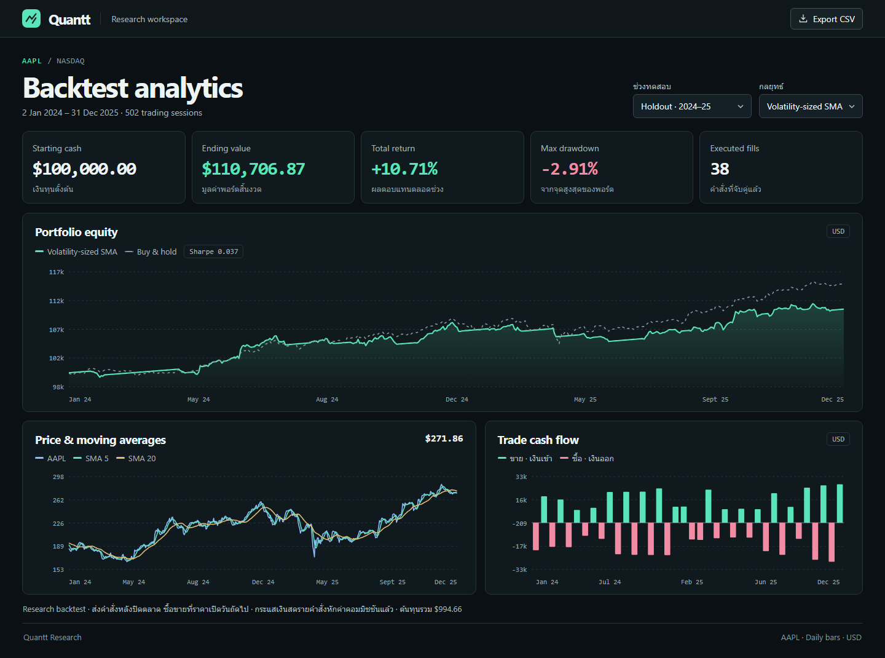

# Quantt Trading Engine

ถ้ากลยุทธ์ใช้สัญญาณซื้อขายเดิม แต่ถือหุ้นน้อยลงครึ่งหนึ่งในวันที่ตลาดผันผวน พอร์ตจะขาดทุนจากจุดสูงสุดน้อยลงแค่ไหน และกำไรหลังต้นทุนยังคุ้มไหม? โปรเจกต์นี้ทดลองคำถามนั้นกับหุ้น Apple (AAPL) โดยใช้ Python จำลองคำสั่งซื้อขาย และให้ตรวจผลย้อนหลังได้ถึงระดับรายวัน



*ภาพแสดงกลยุทธ์ SMA ที่ลดขนาดสถานะตามความผันผวน ในช่วงสองปีที่กันไว้ทดสอบ พอร์ตเริ่มที่ $100,000 และสิ้นสุดที่ $110,706.87 รวมดอกเบี้ยเงินสดแล้ว*

## ลองดูผลใน 1 นาที

หากมีโค้ดในเครื่องแล้ว เปิด [ไฟล์แดชบอร์ด](docs/dashboard.html) ในเบราว์เซอร์ได้เลย หากอยู่บน GitHub ให้เปิดไฟล์ตามลิงก์ เลือก **Download raw file** แล้วเปิดไฟล์ HTML ที่ดาวน์โหลดมา ข้อมูลและกราฟอยู่ในไฟล์เดียว ใช้งานแบบออฟไลน์ได้

1. เลือก **Holdout · 2024–25** เพื่อดูผลในช่วงที่กันไว้ทดสอบ หรือ **Demo · 60 bars** เพื่อดูตัวอย่างสั้นที่มีคำสั่งซื้อขายเพียง 2 ครั้ง
2. ในช่วง Holdout สลับระหว่าง **SMA 5/20**, **Volatility-sized SMA** และ **Buy & hold** แล้วดูว่ากราฟมูลค่าพอร์ตและการขาดทุนจากจุดสูงสุดเปลี่ยนอย่างไร
3. เลื่อนเมาส์บนกราฟเพื่อดูค่าแต่ละวัน กราฟกระแสเงินสดแสดงเงินจ่ายเมื่อซื้อและเงินรับเมื่อขาย กด **Export CSV** เพื่อบันทึกข้อมูลของมุมมองที่เลือก

แดชบอร์ดที่แนบเป็นภาพรวมข้อมูล ณ รอบที่จัดทำ เมื่อรันการทดลองใหม่ ให้อ่านผลรอบนั้นจากไฟล์ CSV ที่โปรแกรมสร้าง

## รันงานวิจัยบนเครื่อง

ใช้ **Python 3.10 ขึ้นไป** และไลบรารีมาตรฐาน หลังจาก clone หรือดาวน์โหลด repository แล้ว ให้เปิดเทอร์มินัลในโฟลเดอร์ที่มี `research.py` ข้อมูลรายวันสำหรับรันซ้ำมีอยู่ใน `data/` แล้ว

```bash
python research.py --output results
python -m unittest -v test_research
```

คำสั่งแรกรายงานผลทั้งช่วงพัฒนาและช่วงทดสอบ คำสั่งที่สองตรวจ 6 กรณี รวมถึงการซื้อขายที่ราคาเปิดแท่งถัดไป การคิดต้นทุนสถานะ short และการตรวจว่าการเปลี่ยนราคาในอนาคตไม่กระทบการตัดสินใจในอดีต บนระบบที่เรียก Python 3 ด้วย `python3` ให้ใช้ชื่อนั้นแทน `python`

| สิ่งที่อยากดู | เปิดหลังรัน |
|---|---|
| กำไรสุทธิ กำไรเทียบกับเงินสด Sharpe และ drawdown ของแต่ละกลยุทธ์ | `results/summary.csv` |
| เงินสด จำนวนหุ้น ราคาเปิด ราคาที่จับคู่ และต้นทุนรายวัน | `results/holdout_daily.csv` หรือ `results/development_daily.csv` |
| ช่วงความเชื่อมั่นของส่วนต่าง Sharpe ระหว่าง SMA ทั้งสองแบบ | `results/holdout_interval.csv` |

หากต้องการรันตัวอย่างเริ่มต้นจาก Quantt Studio ใช้ `python main.py` ตัวอย่างนี้ใช้ข้อมูล 60 แท่งและจำลองการซื้อขายที่ราคาปิดของแท่งสัญญาณ ส่วนการทดลองหลายปีใช้ราคาเปิดวันถัดไป

## การทดลองทำงานอย่างไร

- **ข้อมูล** ใช้ราคา AAPL รายวัน 4,024 วัน ระหว่างปี 2010–2025 พร้อมเงินปันผลและผลตอบแทนตั๋วเงินคลังสำหรับเงินสด
- **กลยุทธ์** SMA 5/20 ใช้จังหวะที่ค่าเฉลี่ยราคา 5 วันตัดกับค่าเฉลี่ย 20 วัน รุ่นปรับความเสี่ยงใช้สัญญาณเดียวกันและลดจำนวนหุ้นเป้าหมายครึ่งหนึ่งเมื่อความผันผวนย้อนหลัง 20 วันสูงกว่าเปอร์เซ็นไทล์ที่ 75 ของช่วงฝึก มีพอร์ตซื้อแล้วถือที่กำหนดขนาดจากข้อมูลช่วงฝึกเป็นตัวเทียบ
- **เวลา** ปี 2010–2014 ใช้ตั้งเกณฑ์เริ่มต้น ปี 2015–2023 เดินพอร์ตและปรับเกณฑ์ต้นปีจากข้อมูลเก่า ส่วนปี 2024–2025 ล็อกเกณฑ์ไว้ ประเมินสัญญาณหลังตลาดปิด และซื้อขายที่ราคาเปิดวันถัดไป
- **บัญชีพอร์ต** เงินสดรับดอกเบี้ยตามอัตราที่กำหนด การซื้อขายมีค่าคอมมิชชันและ slippage รวมถึงค่ายืมหุ้นเมื่อถือ short ประเมินมูลค่าพอร์ตทุกวันหลังตลาดปิด

## อ่านผลโดยเทียบกับเงินสด

ช่วงทดสอบปี 2024–2025 เริ่มด้วยเงิน $100,000 เท่ากัน ภายใต้สมมติฐานดอกเบี้ยของระบบ การพักเงินสดตลอดช่วงได้กำไร $10,560.20

| กลยุทธ์ | กำไรสุทธิ | กำไรส่วนเพิ่มเทียบเงินสด | Sharpe | Max drawdown |
|---|---:|---:|---:|---:|
| ซื้อแล้วถือ 64 หุ้น | $14,835.56 | +$4,275.36 | 0.563 | −3.88% |
| SMA 5/20 | $9,336.80 | −$1,223.40 | −0.129 | −5.22% |
| SMA ลดขนาดสถานะ | $10,706.87 | +$146.67 | 0.037 | −2.91% |

การลดขนาดสถานะช่วยลด drawdown ในตัวอย่างนี้ ส่วนต่าง Sharpe เทียบกับ SMA เดิมอยู่ที่ +0.166 และช่วงความเชื่อมั่น 95% อยู่ระหว่าง −0.277 ถึง +0.568 จึงยังสรุปไม่ได้ว่ากฎนี้เพิ่มผลตอบแทนต่อความเสี่ยงได้สม่ำเสมอ [อ่านสมมติฐาน แหล่งข้อมูล และวิธีทดสอบต้นทุนเพิ่มเติม](RESEARCH.md)

โปรเจกต์นี้ต่อยอดจาก Trading Engine ของ [Quantt Studio](https://quantt.io/app/build)

